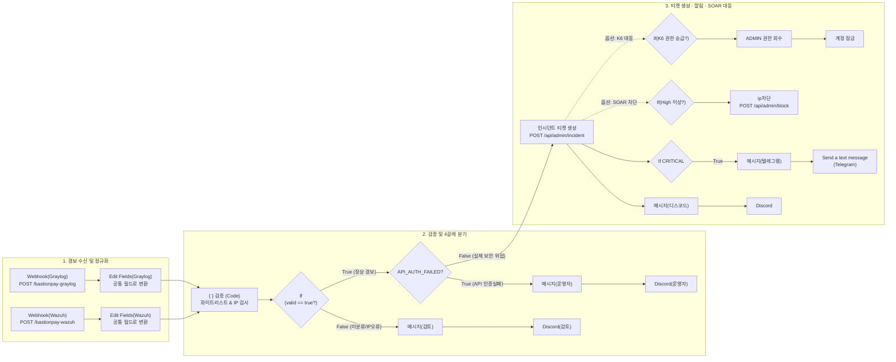

# 🛡️ BastionPay n8n SOAR 구축 가이드 (`README.md`)

이 문서는 **BastionPay 보안 관제 자동화(SOAR) 워크플로(`BastionPay - Security Alert Intake`)**를 처음 접하는 사람도 **이 문서 하나만 보고 처음부터 끝까지 100% 똑같이 구성하고 실행**할 수 있도록 작성된 단계별 구축 매뉴얼입니다.

---

## 📌 1. 이 워크플로는 무슨 일을 하나요? (핵심 요약)

보안 탐지 솔루션인 **Graylog(로그 분석)**와 **Wazuh(호스트 침입 탐지)**에서 이상 징후를 발견해 웹훅(Webhook)을 보내면, **n8n이 중앙 사령탑(SOAR)**이 되어 다음 **4단계**를 자동으로 처리합니다:

1. **수신 (Intake):** Graylog와 Wazuh로부터 24시간 보안 경보를 받습니다 (`HTTP 202` 즉시 응답).
2. **정규화 (Normalization):** 서로 다르게 생긴 Graylog 데이터와 Wazuh 데이터를 **하나의 통일된 표(출발지 IP, 제목, 이벤트 종류, 위험도 등)**로 예쁘게 정리합니다.
3. **검증 및 분류 (Validation & Triage):**
   - 단순 일상 로그(`로그인 성공`, `이체 완료`)는 조용히 **폐기**합니다.
   - 처음 보는 낯선 경보나 IP가 없는 로그는 버리지 않고 **Discord [🔎 수동 검토 필요]** 알림으로 보냅니다.
   - 내부 API 키 오류(`API_AUTH_FAILED`)는 티켓을 만들지 않고 **Discord [⚠️ 운영자 알림]**으로 보냅니다.
4. **대응 및 전파 (Response & Alerting):**
   - 진짜 공격 경보는 BastionPay 백엔드 서버에 **인시던트 티켓을 자동 생성**합니다.
   - **모든 등급(`LOW` ~ `CRITICAL`):** **Discord** 보안 채널로 실시간 경보 카드를 발송합니다.
   - **최고 위험 등급(`CRITICAL`):** **Telegram(텔레그램)** 비상 알림까지 추가로 동시에 발송합니다.
   - **자동 차단(SOAR 옵션):** 설정에 따라 공격자 IP 자동 차단(`/api/admin/block`) 또는 탈취된 ADMIN 권한 회수(`/api/admin/revoke`)·계정 동결(`/api/admin/lock`)을 수행합니다.

---

## 🗺️ 2. 전체 워크플로 구조 한눈에 보기



---

## 🚀 3. 사전 준비 (n8n 실행 및 자격 증명 3가지 등록)

워크플로를 만들기 전에 **n8n 컨테이너 실행**과 **외부 연동 열쇠(Credentials) 3개**를 먼저 등록해야 합니다.

### 3-1. n8n 실행 환경 (Docker 기준)
n8n은 포트 `5678`을 사용합니다. 내부 HTTPS 웹 서버(`https://192.168.3.16`)의 사설 인증서를 신뢰하도록 실행합니다.

```bash
docker run -d --restart unless-stopped \
  --name n8n \
  -p 5678:5678 \
  -v n8n_data:/home/node/.n8n \
  -e TZ=Asia/Seoul \
  n8nio/n8n
```
> **💡 방화벽 보안 권장사항:** 아무나 가짜 웹훅을 쏘지 못하도록, n8n PC의 방화벽에서 `5678` 포트는 **SIEM(Graylog·Wazuh) 서버 IP(`192.168.3.16` 또는 `192.168.3.17`)에서만 접근을 허용**하도록 인바운드 규칙을 제한합니다.

---

### 3-2. 필수 자격 증명(Credentials) 3종 등록하기
브라우저에서 `http://<n8n_IP>:5678`에 접속한 뒤, 왼쪽 사이드바의 **[Credentials] ➔ [Add Credential]**을 눌러 아래 3개를 먼저 만듭니다.

#### ① BastionPay 백엔드 API 인증키 (`Header Auth`)
n8n이 BastionPay 웹 서버에 티켓을 만들거나 차단 명령을 내릴 때 사용하는 비밀번호입니다.
- **검색해서 선택할 종류:** `Header Auth`
- **Credential 이름:** `Header Auth account`
- **Name:** `X-API-Key`
- **Value:** `<YOUR_SECURITY_API_KEY>` *(백엔드 `.env` 또는 `application.yaml`의 `SECURITY_API_KEY` 값 입력)*

#### ② Discord 웹훅 (`Discord Webhook`)
디스코드 채널에 알림을 보내기 위한 주소입니다. (디스코드 채널 설정 ➔ 연동 ➔ 웹후크 ➔ 새 웹후크 ➔ URL 복사)
- **검색해서 선택할 종류:** `Discord Webhook`
- **Credential 이름:** `Discord Webhook account`
- **Webhook URL:** 복사한 디스코드 웹훅 주소 붙여넣기

#### ③ Telegram 봇 (`Telegram API`)
CRITICAL 긴급 장애 시 텔레그램 메시지를 보내기 위한 봇 토큰입니다. (텔레그램 `@BotFather`에서 발급)
- **검색해서 선택할 종류:** `Telegram API`
- **Credential 이름:** `Telegram account`
- **Access Token:** 발급받은 봇 토큰 입력 (예: `123456789:ABCdefGhIJKlmNoPQRsTUVwxyZ`)

---

## ⚡ 4. [가장 빠른 방법] 완성된 JSON 파일로 1분 만에 구성하기

직접 노드를 하나씩 만들 필요 없이, 같은 폴더에 있는 **[`BastionPay - Security Alert Intake.json`](./BastionPay%20-%20Security%20Alert%20Intake.json)** 파일을 불러오면 1분 만에 모든 구성이 끝납니다.

1. n8n 화면 왼쪽 위 **[Workflows] ➔ [Add Workflow]** 클릭
2. 화면 오른쪽 위 점 세 개 버튼 **`[⋯]` ➔ `Import from File...`** 클릭
3. `cjy/BastionPay - Security Alert Intake.json` 파일 선택
4. 화면에 노드들이 짠! 하고 나타나면 아래 **3가지만 내 환경에 맞게 클릭해서 연결**해 줍니다:
   - **`인시던트 티켓 생성` 노드** (및 `ip차단`, `ADMIN 권한 회수`, `계정 잠금` 노드) 더블클릭:
     - **URL:** 현재 BastionPay 웹 서버 IP가 맞는지 확인 (`https://192.168.3.16/api/admin/incident`)
     - **Credential for Header Auth:** 아까 만든 `Header Auth account` 선택
   - **`Discord`, `Discord(검토)`, `Discord(운영자)` 노드** 더블클릭:
     - **Credential for Discord Webhook:** 아까 만든 `Discord Webhook account` 선택
   - **`Send a text message` (텔레그램) 노드** 더블클릭:
     - **Credential for Telegram API:** 아까 만든 `Telegram account` 선택
     - **Chat ID:** 알림을 받을 본인의 텔레그램 숫자 ID 입력 (예: `<YOUR_TELEGRAM_CHAT_ID>`)
5. 우측 상단의 **[Save]**를 누르고, 스위치 토글을 **[Active (초록색)]**로 켜면 즉시 작동합니다!

> **💡 [중요] 팀 운영 정책에 따른 자동 차단(SOAR) 노드 ON/OFF 팁**  
> 만약 **"오탐으로 인한 서비스 장애를 막기 위해 자동 차단(IP 차단, 계정 잠금, 권한 회수)은 빼고 티켓 생성과 알림만 보내기로"** 한 경우:  
> - `If(High 이상?)`, `ip차단`, `If(K6 권한 승급 침해?)`, `ADMIN 권한 회수`, `계정 잠금` 노드를 마우스 우클릭 후 **`Deactivate (비활성화, 단축키 D)`** 하거나 연결선을 지워주시면 **100% 안전한 티켓+알림 전용 모드**로 동작합니다!

---

## 🛠️ 5. [처음부터 직접 만들기] 노드별 상세 설정 백과사전

JSON 임포트 없이 빈 화면에서 직접 노드를 하나씩 추가하며 만들고 싶거나, 각 노드의 내부 코드를 수정하고 싶을 때 아래 표를 보고 그대로 복사해서 붙여넣으세요.

> ⚠️ **초보자 필수 주의사항 (`Expression` 입력 법):**  
> n8n에서 값(Value)을 넣을 때 수식(`{{ ... }}`)이 들어가는 항목은 반드시 입력칸 오른쪽 위의 **`[Fixed | Expression]`** 스위치에서 **`[Expression]`**을 먼저 클릭한 뒤, 아래 적힌 **`{{ ... }}` 구문을 그대로 복사해서 붙여넣어야** 합니다! (Expression 모드에서는 맨 앞에 `=`를 직접 치지 않습니다.)

---

### Step 5-1. 경보 수신 웹훅 노드 2개 만들기 (`Webhook`)

➕ 버튼을 눌러 **`Webhook`** 노드를 2개 만들고 위아래로 배치합니다.

| 설정 항목 | 1번째 웹훅: `Webhook(Graylog)` | 2번째 웹훅: `Webhook(Wazuh)` |
| :--- | :--- | :--- |
| **노드 이름** | `Webhook(Graylog)` | `Webhook(Wazuh)` |
| **HTTP Method** | `POST` | `POST` |
| **Path** | `bastionpay-graylog` | `bastionpay-wazuh` |
| **Respond** | `Immediately` | `Immediately` |
| **Options ➔ Response Code** | `Custom Code` ➔ **`202`** | `Custom Code` ➔ **`202`** |
| **Options ➔ Response Data** | `{"accepted":true}` | `{"accepted":true}` |

> **왜 웹훅을 2개로 나누나요?**  
> Graylog가 보내는 JSON 구조(`event.fields.*`, `backlog[]`)와 Wazuh가 보내는 JSON 구조(`alert.rule.*`, `alert.data.*`)가 완전히 다르기 때문에, 입구를 따로 두어 각각 알맞게 정리(정규화)하기 위해서입니다.

---

### Step 5-2. 데이터 정규화 노드 2개 만들기 (`Edit Fields / Set`)

각 웹훅 오른쪽에 **`Edit Fields (Set)`** 노드를 하나씩 연결합니다.

#### ① `Edit Fields(Graylog)` (`Webhook(Graylog)` 오른쪽에 연결)
- **Mode:** `Manual Mapping`
- **[Add Field]**를 눌러 아래 **13개 필드(String)**를 추가합니다 (`alert_source`만 `Fixed`이고, 나머지 12개는 모두 **`Expression`** 모드입니다):

| 필드 이름 (Name) | 모드 | 값 (Value) — 그대로 복사해서 붙여넣기 |
| :--- | :---: | :--- |
| **`src_ip`** | Expression | `{{ [$json.body?.event?.fields?.source_ip, $json.body?.event?.fields?.src_ip, $json.body?.event?.fields?.filebeat_source_ip, $json.body?.event?.group_by_fields?.filebeat_source_ip, $json.body?.event?.group_by_fields?.src_ip, $json.body?.backlog?.[0]?.fields?.filebeat_source_ip, $json.body?.backlog?.[0]?.fields?.source_ip, $json.body?.backlog?.[0]?.fields?.src_ip].find(v => typeof v === 'string' && v && !v.includes('$')) || '' }}` |
| **`title`** | Expression | `{{$json.body?.event_definition_title || $json.body?.event?.message || ''}}` |
| **`event_type`** | Expression | `{{ [$json.body?.event?.fields?.event_type, $json.body?.event?.fields?.rule, $json.body?.backlog?.[0]?.fields?.filebeat_event_type, $json.body?.backlog?.[0]?.fields?.event_type, $json.body?.backlog?.[0]?.fields?.rule].find(v => typeof v === 'string' && v !== '' && !v.includes('${') && !v.includes('{{')) || '' }}` |
| **`severity`** | Expression | `{{ String($json.body?.event?.fields?.severity || $json.body?.backlog?.[0]?.fields?.filebeat_severity || ($json.body?.event?.priority >= 3 ? 'HIGH' : ($json.body?.event?.priority === 2 ? 'MEDIUM' : 'LOW')) || 'LOW').replace(/^=/, '').trim().toUpperCase() }}` |
| **`reason_code`** | Expression | `{{ [$json.body?.event?.fields?.reason_code, $json.body?.backlog?.[0]?.fields?.filebeat_reason_code, $json.body?.backlog?.[0]?.fields?.reason_code].find(v => typeof v === 'string' && v && !v.includes('$')) || '' }}` |
| **`graylog_event_id`** | Expression | `{{ $json.body?.event?.id || $json.body?.backlog?.[0]?.id || '' }}` |
| **`trace_id`** | Expression | `{{ [$json.body?.event?.fields?.trace_id, $json.body?.backlog?.[0]?.fields?.filebeat_trace_id, $json.body?.backlog?.[0]?.fields?.trace_id].find(v => typeof v === 'string' && v && !v.includes('$')) || '' }}` |
| **`member_id`** | Expression | `{{ [$json.body?.event?.fields?.member_id, $json.body?.backlog?.[0]?.fields?.filebeat_member_id, $json.body?.backlog?.[0]?.fields?.member_id].find(v => v !== undefined && v !== null && String(v) !== '' && !String(v).includes('$')) ?? '' }}` |
| **`transfer_id`** | Expression | `{{ [$json.body?.event?.fields?.transfer_id, $json.body?.backlog?.[0]?.fields?.filebeat_transfer_id, $json.body?.backlog?.[0]?.fields?.transfer_id].find(v => v !== undefined && v !== null && String(v) !== '' && !String(v).includes('$')) ?? '' }}` |
| **`amount`** | Expression | `{{ [$json.body?.event?.fields?.amount, $json.body?.backlog?.[0]?.fields?.filebeat_amount, $json.body?.backlog?.[0]?.fields?.amount].find(v => v !== undefined && v !== null && String(v) !== '' && !String(v).includes('$')) ?? '' }}` |
| **`currency`** | Expression | `{{ [$json.body?.event?.fields?.currency, $json.body?.backlog?.[0]?.fields?.filebeat_currency, $json.body?.backlog?.[0]?.fields?.currency].find(v => typeof v === 'string' && v && !v.includes('$')) || '' }}` |
| **`outcome`** | Expression | `{{ [$json.body?.event?.fields?.outcome, $json.body?.backlog?.[0]?.fields?.filebeat_outcome, $json.body?.backlog?.[0]?.fields?.outcome].find(v => typeof v === 'string' && v && !v.includes('$')) || '' }}` |
| **`alert_source`** | **Fixed** | `graylog` |

---

#### ② `Edit Fields(Wazuh)` (`Webhook(Wazuh)` 오른쪽에 연결)
- **Mode:** `Manual Mapping`
- **[Add Field]**를 눌러 아래 **16개 필드(String)**를 추가합니다 (`alert_source`만 `Fixed`이고, 나머지는 모두 **`Expression`** 모드입니다):

| 필드 이름 (Name) | 모드 | 값 (Value) — 그대로 복사해서 붙여넣기 |
| :--- | :---: | :--- |
| **`wazuh_rule_id`** | Expression | `{{ $json.body?.alert?.rule?.id || $json.body?.rule?.id || '' }}` |
| **`wazuh_rule_description`** | Expression | `{{ $json.body?.alert?.rule?.description || $json.body?.rule?.description || '' }}` |
| **`wazuh_level`** | Expression | `{{ String($json.body?.alert?.rule?.level ?? $json.body?.rule?.level ?? '') }}` |
| **`alert_source`** | **Fixed** | `wazuh` |
| **`src_ip`** | Expression | `{{ $json.body?.alert?.data?.source_ip || $json.body?.alert?.data?.srcip || $json.body?.alert?.srcip || '' }}` |
| **`title`** | Expression | `{{ String($json.body?.alert?.rule?.id ?? $json.body?.rule?.id ?? '') === '100274' ? 'BastionPay | 차단된 IP의 반복 접근' : ($json.body?.alert?.rule?.description || $json.body?.rule?.description || 'Wazuh 경보') }}` |
| **`event_type`** | Expression | `{{ $json.body?.alert?.data?.event_type || $json.body?.alert?.event_type || '' }}` |
| **`severity`** | Expression | `{{ (() => { const a = $json.body?.alert ?? $json.body ?? {}; const rank = { INFO: 0, LOW: 1, MEDIUM: 2, HIGH: 3, CRITICAL: 4 }; const source = rank[String(a.data?.severity ?? '').toUpperCase()] ?? 0; const level = Number(a.rule?.level ?? 0); const detected = level >= 12 ? 4 : level >= 10 ? 3 : level >= 7 ? 2 : 1; return ['INFO', 'LOW', 'MEDIUM', 'HIGH', 'CRITICAL'][Math.max(source, detected)]; })() }}` |
| **`reason_code`** | Expression | `{{ $json.body?.alert?.data?.reason_code || '' }}` |
| **`event_id`** | Expression | `{{ $json.body?.alert?.data?.event_id || '' }}` |
| **`trace_id`** | Expression | `{{ $json.body?.alert?.data?.trace_id || '' }}` |
| **`member_id`** | Expression | `{{ $json.body?.alert?.data?.member_id ?? '' }}` |
| **`transfer_id`** | Expression | `{{ $json.body?.alert?.data?.transfer_id ?? '' }}` |
| **`amount`** | Expression | `{{ $json.body?.alert?.data?.amount ?? '' }}` |
| **`currency`** | Expression | `{{ $json.body?.alert?.data?.currency || '' }}` |
| **`outcome`** | Expression | `{{ $json.body?.alert?.data?.outcome || '' }}` |

---

### Step 5-3. 합류 및 검증 노드 만들기 (`Code` + `If`)

두 개의 `Edit Fields` 노드에서 나오는 화살표를 모두 하나의 **`검증` (Code)** 노드로 합쳐서 연결합니다.

#### ① `검증` 노드 (`Code` 노드)
- **노드 종류:** `Code`
- **노드 이름:** `검증`
- **Language:** `JavaScript`
- **Mode:** `Run Once for All Items`
- **JavaScript Code:** 기존 내용을 지우고 아래 코드를 통째로 붙여넣습니다:

```javascript
const KNOWN_EVENT_TYPES = new Set([
  'LOGIN_FAILURE', 'ACCOUNT_LOCKED',
  'TRANSFER_REFUNDED', 'TRANSFER_REPLAY', 'TRANSFER_FAILED',
  'TRANSFER_REQUESTED', 'IP_BLOCKED_REQUEST', 'API_AUTH_FAILED',
  'AUTHENTICATION_REQUIRED', 'TIER_CHANGED',
  'ACCESS_DENIED',
  'IDS_ALERT', 'ids-alert',
  'SNORT_PORTSCAN', 'snort-portscan',
]);
const INFO_EVENT_TYPES = new Set(['LOGIN_SUCCESS', 'TRANSFER_COMPLETED']);
const POST_BLOCK_LOGIN_RULE = '100280';
const POST_BLOCK_TRANSFER_RULE = '100281';

const isIp = value => {
  if (typeof value !== 'string') return false;
  const ipv4 = value.match(/^(\d{1,3})\.(\d{1,3})\.(\d{1,3})\.(\d{1,3})$/);
  if (ipv4) return ipv4.slice(1).every(part => Number(part) >= 0 && Number(part) <= 255);
  return /^[0-9a-f:]+$/i.test(value) && value.includes(':');
};

return $input.all()
  .filter(item => !['ROLE_REVOKED'].includes(item.json.event_type))
  .filter(item => {
    const type = item.json.event_type;
    const ruleId = String(item.json.wazuh_rule_id || '');
    // 일반 로그인 성공·이체 완료는 폐기하되, 차단된 IP의 후속 성공(Wazuh 100280)만 통과
    if (type === 'LOGIN_SUCCESS') return ruleId === POST_BLOCK_LOGIN_RULE;
    if (type === 'TRANSFER_COMPLETED') return false;
    return true;
  })
  .map(item => {
    let ip = item.json.src_ip;
    const type = item.json.event_type;
    const ruleId = String(item.json.wazuh_rule_id || '');

    // 파일 변조 등 출발지 IP가 없는 호스트 내부 사건은 웹 서버 자체 IP로 자동 보정
    if ((!ip || ip === '없음') && ruleId) {
      ip = '192.168.3.16';
    }

    const severity = String(item.json.severity || '').replace(/^=/, '').trim().toUpperCase() || 'LOW';
    const knownWazuhCorrelation = [POST_BLOCK_LOGIN_RULE, POST_BLOCK_TRANSFER_RULE].includes(ruleId);
    const valid = isIp(ip) && (KNOWN_EVENT_TYPES.has(type) || knownWazuhCorrelation || Boolean(ruleId));
    return { json: { ...item.json, src_ip: ip, severity, valid } };
  });
```

#### ② `If` 노드 (`검증` 오른쪽에 연결)
- **노드 종류:** `If`
- **노드 이름:** `If`
- **Conditions:**
  - **Value 1 (`Expression`):** `{{ $json.valid }}`
  - **Operation:** `Boolean` ➔ **`is true`**

---

### Step 5-4. 예외 처리 갈래 2개 만들기 (`수동 검토` & `운영자 알림`)

#### 갈래 A: `If` 노드의 **`false`** 출력 ➔ `메시지(검토)` ➔ `Discord(검토)`
사전에 정의되지 않은 낯선 경보나 잘못된 IP 형식이 들어왔을 때 버리지 않고 사람이 검토하도록 보냅니다.

1. **`메시지(검토)` (`Edit Fields / Set` 노드):**
   - Field Name: `text` (String, **`Expression`** 모드)
   - Value:
     ```text
     🔎 BastionPay 수동 검토 필요 (티켓 미생성)    출처: {{ $json.alert_source }}    제목: {{ $json.title }}    출발지 IP: {{ $json.src_ip || '없음' }}    event_type: {{ $json.event_type || '없음' }}    Wazuh rule: {{ $json.wazuh_rule_id || '-' }}
     ```
2. **`Discord(검토)` (`Discord` 노드):**
   - Connection Type: `Webhook`
   - Credential: `Discord Webhook account`
   - Message (`Expression`): `{{ $json.text }}`

---

#### 갈래 B: `If` 노드의 **`true`** 출력 ➔ `API_AUTH_FAILED?` (`If` 노드)
1. **`API_AUTH_FAILED?` (`If` 노드):**
   - **Value 1 (`Expression`):** `{{ $json.event_type }}`
   - **Operation:** `String` ➔ **`is equal to`**
   - **Value 2 (`Fixed`):** `API_AUTH_FAILED`
2. **`API_AUTH_FAILED?`의 `true` 출력 ➔ `메시지(운영자)` ➔ `Discord(운영자)`:**
   - **`메시지(운영자)` (`Edit Fields / Set` 노드):**
     - Field Name: `text` (String, **`Expression`** 모드)
     - Value:
       ```text
       ⚠️ BastionPay API 인증 실패 반복
          출발지 IP: {{ $json.src_ip }}
          제목: {{ $json.title }}
          Graylog 이벤트 ID: {{ $json.graylog_event_id }}
          조치: 호출 주체 확인 (티켓 미생성)
       ```
   - **`Discord(운영자)` (`Discord` 노드):**
     - Connection Type: `Webhook` / Credential: `Discord Webhook account`
     - Message (`Expression`): `{{ $json.text }}`

---

### Step 5-5. 핵심: `인시던트 티켓 생성` 노드 만들기 (`HTTP Request`)

`API_AUTH_FAILED?` 노드의 **`false`** 출력에 **`HTTP Request`** 노드를 연결합니다.

- **노드 이름:** `인시던트 티켓 생성`
- **Method:** `POST`
- **URL:** `https://192.168.3.16/api/admin/incident` *(웹 서버 IP 확인)*
- **Authentication:** `Generic Credential Type`
- **Generic Auth Type:** `Header Auth`
- **Credential for Header Auth:** `Header Auth account` 선택
- **Send Body:** `ON (활성화)`
- **Body Content Type:** `JSON`
- **Specify Body:** `Using Fields Below`
- **Body Parameters (4개 추가):**
  1. Name: `src_ip` / Value (`Expression`): `{{ $json.src_ip }}`
  2. Name: `title` / Value (`Expression`): `{{ $json.title }}`
  3. Name: `severity` / Value (`Expression`):
     ```javascript
     {{ String($json.severity || '').includes('CRITICAL') ? 'CRITICAL' : (String($json.severity || '').includes('HIGH') ? 'HIGH' : (String($json.severity || '').includes('MEDIUM') ? 'MEDIUM' : 'LOW')) }}
     ```
  4. Name: `hours` / Value (`Fixed`): `24`
- **Options ([Add Option] 클릭):**
  - **Ignore SSL Issues (Insecure):** **`ON (활성화)`** *(내부 자체 서명 인증서 오류 방지)*
  - **Timeout:** `10000`

---

### Step 5-6. 티켓 생성 후 알림 발송 (Discord & Telegram)

`인시던트 티켓 생성` 노드 오른쪽 출력에서 동시에 여러 갈래로 선을 뻗어 연결합니다.

#### ① 기본 Discord 경보 (`메시지(디스코드)` ➔ `Discord`)
모든 보안 티켓에 대해 디스코드 알림을 보냅니다.

1. **`메시지(디스코드)` (`Edit Fields / Set` 노드):**
   - Field Name: `text` (String, **`Expression`** 모드)
   - Value:
     ```javascript
     🚨 BastionPay 보안 인시던트
     제목: {{$json.incident.title}}
     심각도/상태: {{$json.incident.severity}} / {{$json.incident.status}}
     출발지 IP: {{$json.incident.src_ip}}
     관련 이벤트 수: {{$json.incident.event_count}}
     조치: {{$json.incident.actions || '없음'}}
     티켓 ID: {{$json.incident.id}}
     상세: BastionPay 보안 대시보드에서 티켓 ID로 확인
     {{ (() => { const v = $('검증').first().json; if (v.alert_source !== 'graylog') return '거래 ID: ' + (v.transfer_id || '-'); const b = $('Webhook(Graylog)').first().json.body ?? {}; const valid = x => x !== undefined && x !== null && String(x).trim() !== '' && !String(x).includes('${'); const backlog = b.backlog ?? []; const ids = [...new Set(backlog.map(m => m.fields?.filebeat_transfer_id ?? m.fields?.transfer_id).filter(valid).map(String))]; if ((v.title ?? '').includes('S3_')) return '관련 거래 ID: ' + (ids.join(', ') || '원본 로그에서 확인'); const one = [b.event?.fields?.transfer_id, backlog[0]?.fields?.filebeat_transfer_id, backlog[0]?.fields?.transfer_id, v.transfer_id].find(valid); return '거래 ID: ' + (one ?? '-'); })() }}
     ```
2. **`Discord` (`Discord` 노드):**
   - Connection Type: `Webhook` / Credential: `Discord Webhook account`
   - Message (`Expression`): `{{ $json.text }}`

---

#### ② CRITICAL 전용 Telegram 비상 알림 (`If CRITICAL` ➔ `메시지(텔레그램)` ➔ `Send a text message`)
티켓 등급이 `CRITICAL`일 때만 텔레그램으로 긴급 푸시 알림을 쏩니다.

1. **`If CRITICAL` (`If` 노드):**
   - **Value 1 (`Expression`):** `{{ $json.incident.severity }}`
   - **Operation:** `String` ➔ **`is equal to`**
   - **Value 2 (`Fixed`):** `CRITICAL`
2. **`메시지(텔레그램)` (`Edit Fields / Set` 노드 — `If CRITICAL`의 `true`에 연결):**
   - Field Name: `text` (String, **`Expression`** 모드)
   - Value:
     ```text
     🚨 BastionPay 보안 인시던트
     {{$json.incident.title}}
     심각도: {{$json.incident.severity}} / 상태: {{$json.incident.status}}
     출발지 IP: {{$json.incident.src_ip}}
     관련 이벤트: {{$json.incident.event_count}}건
     조치: {{$json.incident.actions || '없음'}}
     티켓 ID: {{$json.incident.id}}
     ```
3. **`Send a text message` (`Telegram` 노드):**
   - Credential: `Telegram account`
   - Resource: `Message` / Operation: `Send Message`
   - **Chat ID:** 본인의 텔레그램 Chat ID 입력 (예: `<YOUR_TELEGRAM_CHAT_ID>`)
   - **Text (`Expression`):** `{{ $json.text }}`

---

### Step 5-7. (선택) SOAR 자동 차단 노드 구성

`인시던트 티켓 생성` 노드 오른쪽에 연결되어 자동 차단을 수행하는 갈래입니다. (수동 관제 정책 시 비활성화 가능)

#### ① HIGH 이상 공격자 IP 자동 차단 (`If(High 이상?)` ➔ `ip차단`)
1. **`If(High 이상?)` (`If` 노드):**
   - **Value 1 (`Expression`):** `{{ ['HIGH', 'CRITICAL'].includes($json.incident?.severity) }}`
   - **Operation:** `Boolean` ➔ **`is true`**
2. **`ip차단` (`HTTP Request` 노드 — `true`에 연결):**
   - Method: `POST` / URL: `https://192.168.3.16/api/admin/block`
   - Authentication: `Generic Credential Type` ➔ `Header Auth` (`Header Auth account`)
   - Send Body: `ON` / Content Type: `JSON` / Specify Body: **`Using JSON`**
   - **JSON (`Expression`):**
     ```javascript
     {{ JSON.stringify({ ip: $('인시던트 티켓 생성').item.json.incident.src_ip, reason: "SOAR 자동 차단: " + $('인시던트 티켓 생성').item.json.incident.title }) }}
     ```
   - Options: `Ignore SSL Issues`: `ON`

#### ② K6 권한 승급 침해 시 권한 박탈 및 계정 동결 (`If(K6 권한 승급 침해?)` ➔ `ADMIN 권한 회수` ➔ `계정 잠금`)
1. **`If(K6 권한 승급 침해?)` (`If` 노드):**
   - **Value 1 (`Expression`):** `{{ $json.incident.title }}`
   - **Operation:** `String` ➔ **`contains`**
   - **Value 2 (`Fixed`):** `권한 승급`
2. **`ADMIN 권한 회수` (`HTTP Request` 노드 — `true`에 연결):**
   - Method: `POST` / URL: `https://192.168.3.16/api/admin/revoke`
   - Authentication: `Header Auth` (`Header Auth account`)
   - Specify Body: **`Using JSON`** (`Expression`):
     ```javascript
     {{ JSON.stringify({ member_id: Number($('Edit Fields(Graylog)').item.json.member_id || 1), reason: "SOAR 자동 대응: 비정상 ADMIN 권한 탈취 감지" }) }}
     ```
   - Options: `Ignore SSL Issues`: `ON`
3. **`계정 잠금` (`HTTP Request` 노드 — `ADMIN 권한 회수` 오른쪽에 연결):**
   - Method: `POST` / URL: `https://192.168.3.16/api/admin/lock`
   - Authentication: `Header Auth` (`Header Auth account`)
   - Specify Body: **`Using JSON`** (`Expression`):
     ```javascript
     {{ JSON.stringify({ member_id: Number($('Edit Fields(Graylog)').item.json.member_id || 1), reason: "SOAR 자동 대응: 권한 승급 계정 동결" }) }}
     ```
   - Options: `Ignore SSL Issues`: `ON`

---

## 🧪 6. 잘 만들어졌는지 10초 만에 테스트하는 방법 (`curl`)

구성을 마치고 우측 상단 **`Active`** 스위치를 켠 뒤, 터미널(PowerShell 또는 Kali Linux)에서 아래 명령어를 쳐서 각 분기가 초록불로 잘 통과하는지 바로 확인하세요!

### 테스트 1: 일반 보안 위협 (티켓 생성 + Discord 알림 확인)
```bash
curl -X POST "http://192.168.3.12:5678/webhook/bastionpay-graylog" \
  -H "Content-Type: application/json" \
  -d '{
    "event_definition_title": "BastionPay | K2_Hydra 로그인 브루트포스 탐지",
    "event": {
      "id": "test-k2-001",
      "priority": 2,
      "fields": {
        "source_ip": "192.168.3.202",
        "event_type": "LOGIN_FAILURE",
        "severity": "MEDIUM"
      }
    }
  }'
```
- **정상 결과:** BastionPay 보안 대시보드에 `MEDIUM` 티켓이 생기고, **Discord**에 알림이 도착합니다.

### 테스트 2: CRITICAL 침해 사고 (티켓 생성 + Discord + Telegram 동시 발송 확인)
```bash
curl -X POST "http://192.168.3.12:5678/webhook/bastionpay-graylog" \
  -H "Content-Type: application/json" \
  -d '{
    "event_definition_title": "BastionPay | K6_비정상 ADMIN 권한 승급 침해 탐지",
    "event": {
      "id": "test-k6-001",
      "priority": 3,
      "fields": {
        "source_ip": "192.168.3.207",
        "event_type": "TIER_CHANGED",
        "severity": "CRITICAL",
        "member_id": "2"
      }
    }
  }'
```
- **정상 결과:** `CRITICAL` 티켓이 생성되며, **Discord와 Telegram 양쪽 모두** 비상 알림이 울립니다.

### 테스트 3: 모르는 경보 유형 (티켓 미생성 + Discord [🔎 수동 검토 필요] 확인)
```bash
curl -X POST "http://192.168.3.12:5678/webhook/bastionpay-graylog" \
  -H "Content-Type: application/json" \
  -d '{
    "event_definition_title": "알 수 없는 테스트 이벤트",
    "event": {
      "id": "test-unknown-001",
      "fields": {
        "source_ip": "192.168.3.250",
        "event_type": "UNKNOWN_WEIRD_EVENT"
      }
    }
  }'
```
- **정상 결과:** 티켓은 생성되지 않고, **Discord**에 `🔎 BastionPay 수동 검토 필요` 메시지가 도착합니다.

---

## ❓ 7. 자주 겪는 문제 해결 (Troubleshooting)

1. **`인시던트 티켓 생성` 노드에서 빨간불(`SSL Error / Self-signed certificate`)이 떠요!**
   - `인시던트 티켓 생성` 노드를 더블클릭 ➔ 맨 아래 `Options` ➔ **`Ignore SSL Issues (Insecure)`** 가 **`ON`**으로 켜져 있는지 확인하세요.
2. **Discord나 Telegram에 변수 값 대신 `{{$json.incident.title}}` 글자가 그대로 찍혀요!**
   - 메시지 노드(`메시지(디스코드)` 등)에서 입력칸 오른쪽 위의 **`[Fixed | Expression]`** 스위치가 `Fixed`로 되어 있어서 그렇습니다. **`[Expression]`**으로 눌러주시면 정상적으로 값이 변환됩니다.
3. **Graylog에서 알림을 보냈는데 n8n `Executions` 탭에 아무것도 안 떠요!**
   - ① 워크플로 우측 상단 토글이 **`Active`(초록불)** 상태인지 확인하세요. (`Active`가 아니면 `/webhook-test/...` 주소로만 열립니다.)
   - ② n8n PC(D 컴퓨터)의 Windows 방화벽에서 `5678` 포트가 현재 Graylog 서버 IP(`192.168.3.16` 또는 `192.168.3.17`)를 허용하고 있는지 확인하세요.

